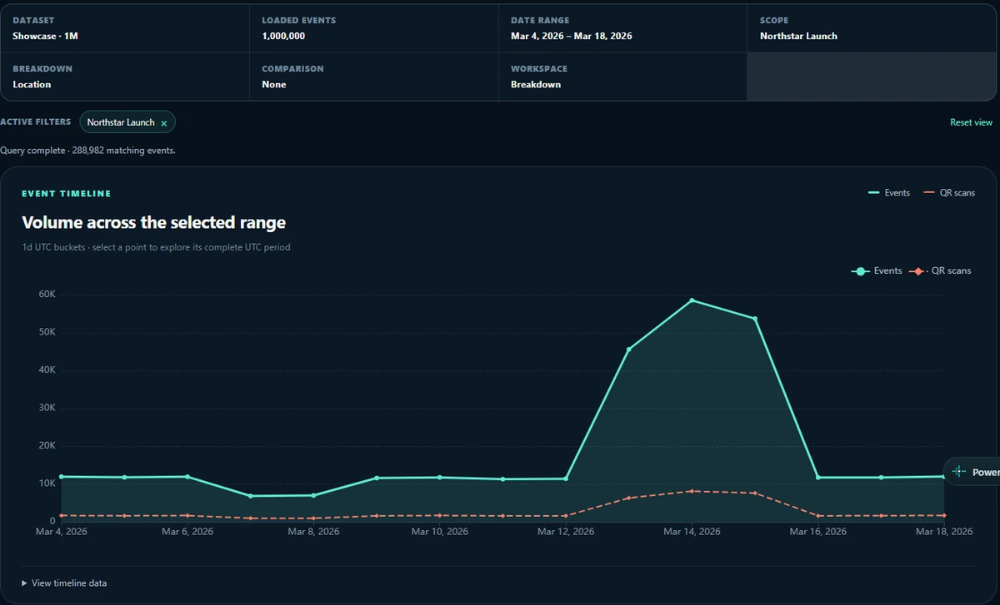
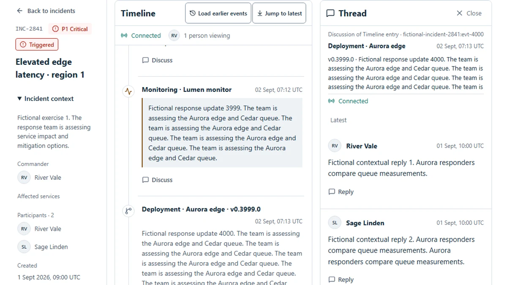
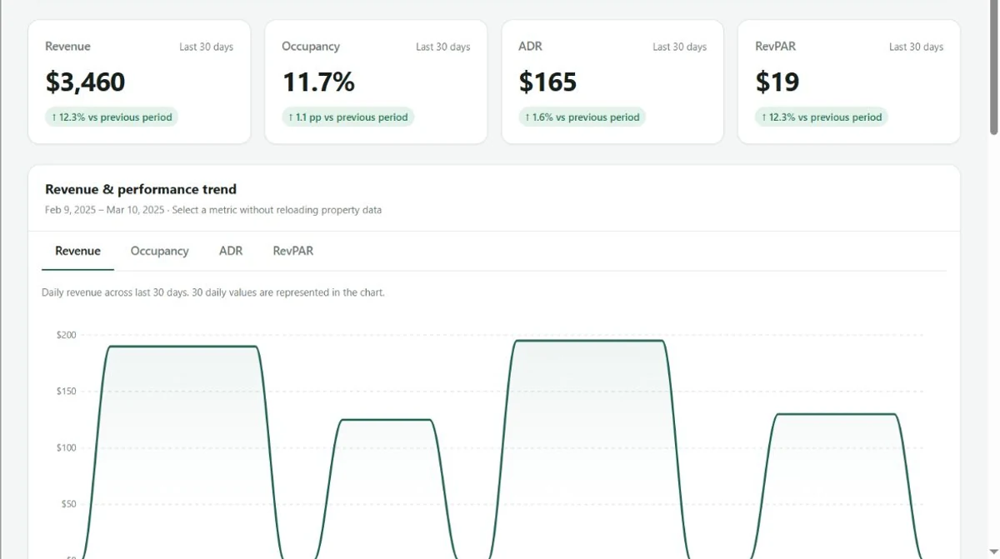

# Oles Chernyy

**Frontend Engineer · Vue / Nuxt · React / Next.js · TypeScript** 5+ years building web applications, dashboards, and maintainable frontend systems. [Telegram](https://t.me/AlexCh90) · [Featured projects ↓](#featured-projects) · [GitHub](https://github.com/olestch) · Saint Petersburg, Russia

| Vue / Nuxt · primary commercial stack | React / Next.js · additional experience |
| --- | --- |
| Vue 2 / 3 · Nuxt 2 / 3 · TypeScript Pinia / Vuex · Vue Router · Vuetify | React 19 · Next.js 16 · TypeScript Redux Toolkit · TanStack Query · Zod |

## Featured projects

### EventScope · [Live Demo](https://eventscopevue.netlify.app/explore) · [Source Code](https://github.com/olestch/eventscope)

Explore up to **1M events** with charts, filters, and heatmaps. **Web Worker processing · 261 tests.** Vue 3 · Nuxt 3 · TypeScript · ECharts · Web Workers · Vitest

### Incident Room · [Live Demo](https://incident-room.netlify.app/) · [Source Code](https://github.com/olestch/incident-room)

Investigate incidents with team discussions and simulated real-time updates. **Virtualized timelines · Delivery recovery.** React 19 · Next.js 16 · TypeScript · Redux Toolkit · TanStack Query · Vitest · Playwright

### Hospitality Operations Dashboard · [Live Demo](https://hospitality-operations-dashboard.netlify.app/) · [Source Code](https://github.com/olestch/hospitality-operations-dashboard)

Explore hotel bookings, performance, and daily operations. **Read-only workflows · Responsive, modular UI.** Vue 3 · TypeScript · Pinia · Vite · ApexCharts · Vitest

**Also:** REST APIs · SCSS · Vue/Nuxt migrations · Git · Docker · CI/CD. All projects use fictional demo data. **AI:** Codex · Claude · ChatGPT daily for building, debugging, and testing; I review and test the output.
